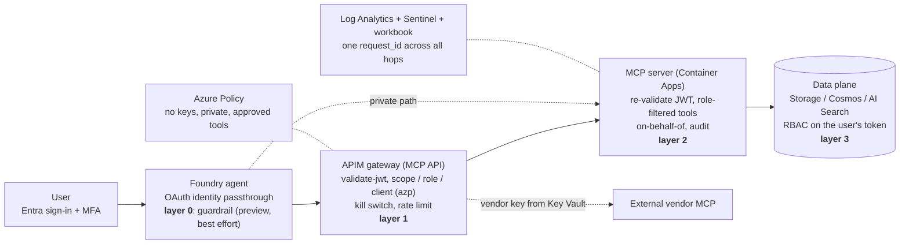

# Agents Behind the Wall

**Azure-native, keyless, on-behalf-of AI agents for Capital Markets - with the proof.**
An end-to-end reference that answers the six questions that stop regulated-industry agent pilots, and shows each control by trying to break it.

## The thesis

> Keys bypass Conditional Access. A missing user context bypasses data-level RBAC, Purview and every audit trail you own.
> Fix the *identity chain* (user → agent → gateway → tool → data) and every other control - policy, monitoring, records, InfoSec visibility - lights up on its own.



## The six questions, and where each is answered

| # | FSI pain point | How it is closed here | Proof |
|---|---|---|---|
| 1 | "No keys." | Foundry, Storage, Cosmos, Search, ACR, Key Vault: Entra only (a query proves 0 key-based requests). Azure Policy denies key auth and keyed Foundry connections. The one external vendor key lives in Key Vault → APIM, never seen by an agent or a user. | P01, P07, P11 |
| 2 | On-behalf-of | Each MCP server exchanges the **user's** token (federated credential, no secret) for the data plane; Azure RBAC - not our code - decides. | P03, P04, P10 |
| 3 | User auth on internal / external / private MCP | internal = APIM + ACA (Entra JWT + OBO); external = vendor MCP behind APIM (key injected at the gateway); private = ACA internal ingress, reachable only from the VNet-injected agent runtime. | P02, P06, P07 |
| 4 | "How are people using agents?" | `AbwUsageByUser`, `AbwAgentActivity`, the cockpit workbook: users, agents, tools, denials, latency. | P17 |
| 5 | InfoSec visibility into governance | Policy compliance, 9 Sentinel analytics rules, one correlated trace per `request_id`, WORM audit blob. | P10, P11, P13, P17 |
| 6 | MNPI information barrier | Wall roles gate deal data at the gateway, at the tool list/call and - independently - at Azure Storage. | P03, P08 |
| 7 | Human in the loop for irreversible actions | `require_approval` on `place_order`; refusal blocks, approval places it as the user. | P05 |
| 8 | Containment | Kill switch (≈ 1 min; the four governed servers behind APIM), client allow-list (≈ 1 min), per-user rate limit, entitlement drift (under a minute), prompt-injection guardrail. | P09, P12, P14, P15, P16 |

The wall (each layer denies on its own, deterministically): **1** APIM gateway · **2** MCP server · **3** data plane. In front of it, **0** the Foundry guardrail on tool output is a *preview, best-effort detection* layer - useful signal, not the control. Azure Policy and observability span all of them. Details: [DESIGN.md](DESIGN.md) section 2.

## What is deployed (≈ 97 resources in one resource group, 103 with the optional jump box)

APIM Standard v2 (MCP APIs, PE + VNet integration) · Foundry account + project + `gpt-54-mini`, network-injected agent subnet, 6 connections, 4 agents · 6 MCP servers on Container Apps (internal environment) · Storage (+WORM audit), Cosmos DB, AI Search - all private-endpoint-only, keys off · Key Vault, ACR, UAMIs · Entra app registrations, app roles, federated credentials, 5 personas · Azure Policy initiative (5 control families) · KQL function pack, 9 Sentinel rules, workbook, alerts · an in-VNet seed job · the **governance extras** (`scripts\extras-*.ps1`; the console shows each as *Live* or as a one-time *portal step*): API Center (approved-tools catalog), Defender for AI (Standard) + the Sentinel Defender connector, a **report-only** Conditional Access policy for the MCP APIs, Entra Agent ID identities for the Foundry agents, the Agent 365 gateway role on APIM, Purview agent plans. Added for Act 7: the **agent front door** (an APIM API at `/agents` that every agent run enters through, with a per-user rate limit and a per-user token budget) and a **cost budget** on the resource group (`budget-abw-demo-eus2-001`; an alert, not a cap). Naming follows CAF: `rg-abw-demo-eus2-001`, `apim-abw-demo-eus2-<u4>`, … (full table in [DESIGN.md](DESIGN.md) section 3). Optional, added later: a **jump box** - a small VM inside the VNet, reached through Azure Bastion Developer - so the private data-plane pages can be opened in the portal; the Demo Console can be installed on it too (`Deploy-JumpBox-Console.bat`), so the whole demo runs from inside the VNet.

## Prerequisites

- Windows with **PowerShell 7**, **Azure CLI** (2.61 was used), **Bicep** (0.48), **Python 3.11**. No local Docker needed (`az acr build`).
- An Azure subscription where you are **Owner**, and an Entra tenant where you can create app registrations, users, groups and grant admin consent (the build used a Global Administrator).
- Capacity in the target region (default `eastus2`): Foundry `gpt-54-mini` GlobalStandard (100K TPM), APIM Standard v2, Container Apps, AI Search Basic (it was placed in `eastus` on build day because `eastus2` had no capacity).
- If the tenant forces MFA and blocks authenticator registration (both tenants this was built in do): an allowed network/device - or a tenant-admin-approved Conditional Access exclusion - for the one-time persona authenticator enrolment. Without it you stay on the admin-as-persona path, which needs neither.
- **`azd`** (any recent version) - only `foundry-connections.ps1` uses it. If it is signed in to another tenant, give it its own config dir (see *Gotchas* below).

## Quickstart

**Fastest path: one command.** `.\scripts\Deploy-AgentWall.ps1 -CheckOnly` is a read-only readiness check that prints the plan; `.\scripts\Deploy-AgentWall.ps1` then runs every step below in order (26 steps, resumable: run it again after any failure), and verifies the result. Everything about it - rights, options, resuming, what is and is not tested - is in [docs\SELF-DEPLOY.md](docs/SELF-DEPLOY.md). The stage-by-stage list below is what it wraps.

From the repo root. Every stage is idempotent (`-WhatIf`, `-NoWait` available). The first `deploy.ps1` run writes `infra\generated\config.json` from your current `az` context (editable: region, names, owner, delete-after tag).

```powershell
az login; az account set --subscription <subscription-id>
python -m venv .venv; .\.venv\Scripts\pip install -r requirements.txt

.\identity\Setup-Entra.ps1 -Phase 1                         # users, groups, apps, roles, grants
.\scripts\deploy.ps1 -Stage preflight                       # RG, providers, operator IP
.\scripts\deploy.ps1 -Stage network
.\scripts\deploy.ps1 -Stage foundry
.\scripts\deploy.ps1 -Stage foundryrbac
.\scripts\deploy.ps1 -Stage platform
.\scripts\build-images.ps1                                  # MCP image (az acr build)
.\scripts\deploy.ps1 -Stage apps
.\identity\Setup-Entra.ps1 -Phase 2                         # federated credentials (secretless OBO)
.\scripts\deploy.ps1 -Stage apim                            # ~30+ min
.\scripts\deploy.ps1 -Stage apis
.\scripts\build-images.ps1 -Target seed
.\scripts\deploy.ps1 -Stage seed                            # in-VNet job loads the synthetic data
.\scripts\foundry-connections.ps1                           # 6 Foundry connections + redirect URIs
.\.venv\Scripts\python.exe src\agent\create_agents.py       # 4 agents
.\scripts\deploy.ps1 -Stage governance                      # policy, guardrail, diagnostics
.\.venv\Scripts\python.exe src\agent\create_agents.py --rai abw-agent-guardrails   # attach the guardrail
.\scripts\deploy.ps1 -Stage observability                   # KQL pack, Sentinel rules, workbook, alerts

.\.venv\Scripts\python.exe demo\prove.py                    # ≈ 30 min (29 min measured), 18 proofs
.\.venv\Scripts\python.exe demo\scoreboard.py --check       # evidence → SCOREBOARD.md
```

Then, for persona sign-in (priya, wes, tara, …):  the only part that needs a human (authenticator enrolment + per-connection OAuth consent). Without it, `identity\Use-AdminAsPersona.ps1` mirrors a persona's roles onto the signed-in admin.

- **Baseline before consent.** Run `.\identity\Use-AdminAsPersona.ps1 -As wes -Also tara` *before* the first agent consent. Foundry stores the token it gets at consent and reuses it for its whole life (60-90 min), and it also holds the tool list an agent saw (≈ 15-20 min measured). A role-less first consent makes the agent show `(none)` for wall / actions / private and 403 on vendor long after you fixed the roles.
- **`-Force` does not reset consent.** `foundry-connections.ps1 -Force` overwrites in place and keeps the connector, redirect URL and stored token. To force a fresh consent: `az rest --method delete --url "https://management.azure.com<connectionId>?api-version=2025-06-01"` (ids are in `infra\generated\connections.json`), then `.\scripts\foundry-connections.ps1 -Only <name>`.
- **`azd` in the wrong tenant** ("Tenant provided in token does not match resource token"): give it its own config dir and reuse the az login -
  `$env:AZD_CONFIG_DIR = "$PWD\.secrets\azd"; azd config set auth.useAzCliAuth true; azd extension install azure.ai.connections`.
- **First `governance` run in a brand-new tenant** can fail once on policy exemptions with `CheckAccessPrincipalCreationConcurrencyError` / `CheckAccessPrincipalTokenInvalid` (the tenant's first RBAC check-access calls). Wait ~75 s and re-run the stage.
- **A tenant-root policy baseline may pre-empt your Deny.** In the tenant used for the final proof an org-level initiative (management-group scope) runs *Modify* effects first, so three of our "denied" attempts (Storage shared key, Cosmos local auth, Foundry local auth) are *corrected to a safe state* instead of refused. `demo\try-violations.py` reports BLOCKED / CORRECTED / ALLOWED and P11 passes on "no unsafe resource is left behind". Do not bypass such a baseline.
- **The guardrail is intermittent.** Same request, same policy: the preview tool-response intervention fired on only some runs (1 in 11 to 5 in 8 in our measurements). Do not build a live demo beat on it - show a stored blocked trace and the ABW-008 incident, or keep asking (P09 does, up to 40 attempts, and reports the rate).
- **Consent needs the operator's browser session.** `ask.py --open-consent` opens your default browser; if that is signed in as someone else, point Python at a private window of the right browser first: `$env:BROWSER = '"C:\Program Files (x86)\Microsoft\Edge\Application\msedge.exe" --inprivate %s'`.

`prove.py` options: `--list`, `--only P03,P05`, `--skip`, `--group core|agent|ops|policy|verify`, `--verify`, `--restore`, `--force`. The core group takes ≈ 2 minutes.

## Run the demo

**Double-click `Start-Console.bat`** (or `.\.venv\Scripts\python.exe console\server.py`). It opens the **Demo Console** at `http://127.0.0.1:8787` - the next free port if that one is taken; it listens on localhost only, uses your `az login`, and needs no terminal on stage.

- **Seven acts, one big button per beat:** 1 Two answers (legacy vs governed) · 2 No keys · 3 Whose hands · 4 Goes wrong · 5 What InfoSec sees · 6 End to end (one request through every layer) · 7 Roles & cost (every person, the agent's front door, the bill; a back-pocket act). Every result is plain English first, technical detail one click below.
- **Act 6 - one request, every layer:** pick a scenario - a wrong password, a key instead of Entra, no access to an MCP server, the wrong deal, a Storage denial (replayed from the logs), a jailbreak - then the two allowed runs. Each gives a **twelve-row board**: Entra login, Conditional Access, guardrails, agent, AI gateway, MCP server and data on the path, and Monitor, Sentinel, Defender, Azure Policy and Agent 365 as watchtowers. It shows where the request stopped and who saw it, and every row has a *Where to click* in the portal and a *Query*. Press **Refresh from logs** about 15 minutes later to fill in the log-based rows. 
- **Act 7 - roles, the agent's front door and the bill (back pocket):** a tab for each person (Priya, Wes, Tara, Carla, Ian) with one allowed and one refused request made with that person's own token; an **Admin** tab where the operator runs the deployed agents against each MCP server in turn, then the old key-only agent and the attacks (eleven scenarios); and an **Overview** that runs the role matrix - one allowed and one refused request per person, each with that person's own token (a person who has not signed in shows the designed result, with a dashed border) - above a coverage table of MCP servers, agents and logs. Around them: 7.1 tests the APIM **front door** the agent is entered through (its tool calls return through APIM), 7.3 is a **FinOps board** (spend by service, tokens per user and agent) and 7.4 cuts one user's token budget to show a runaway agent stopped at the front door before any model call.
- **Prove it's real:** every beat and every box of the clickable architecture strip opens a drawer with *live, read-only facts from Azure* and a deep link into the real portal blade - Foundry, APIM, Monitor / Sentinel, Defender for Cloud, Purview, Entra Agent ID, Agent 365, Azure Policy, API Center, Conditional Access. Act 5 ends with a 12-card **Governance tour** of those services.
- **Control Room** (every governing service, *Live* or *Portal step*) and **Scoreboard** (the 18 proofs, from the evidence files).
- **Acting as** (top of the left rail, key `P`): run the *gateway* beats as Priya, Wes, Tara, Carla or Ian once each has signed in (a one-time MFA enrolment per persona); the agent beats always run as the operator. In Act 6 it applies to 6.4 and 6.7; 6.3 always runs as Priya (or Ian). In Act 7 each person's tab runs as that person. 
- **Jump box** (optional): double-click `Start-JumpBox.bat` to start a small VM inside the VNet and open it in the portal, then Connect > Bastion, so the private Storage / Cosmos / Search / Foundry data pages open from a browser that can resolve the private endpoints.
- **Run the demo from the jump box** (optional): double-click `Deploy-JumpBox-Console.bat` once (safe to repeat; `-WhatIf` sends nothing) to install the Demo Console on that VM - Python, the Azure CLI and PowerShell 7 if missing, then the package, which holds no key, token or persona password. On show day: `Start-JumpBox.bat` > Bastion > the **ABW Demo Console** desktop shortcut (one device-code `az login` as the admin the first time). Persona sign-in files are copied only on request (`pwsh scripts\jumpbox-console.ps1 -IncludePersonaFiles`, locked to SYSTEM and the VM admin; `-RemovePersonaFiles` deletes them) 
- `N` presenter notes · `P` Acting as · `1`-`7` jump to an act · `Esc` closes a panel · **Preflight** checks the baseline · **Reset demo** restores it after the disruptive scenes.


## Teardown

```powershell
.\scripts\teardown.ps1 -WhatIf          # read-only plan first
.\scripts\teardown.ps1 -Yes             # report-only CA policy + Agent 365 grant → capability hosts → Log Analytics → RG → soft-delete purge → policy objects → Entra
```

Flags: `-KeepEntra`, `-SkipPurge`, `-CleanLocal` (deletes `.secrets\` and `infra\generated\` wholesale, including the jump box password and state). The jump box lives in the same resource group, so the teardown removes it too (the console on it and any persona sign-in files go with the VM); `.\scripts\jumpbox.ps1 -Remove` removes only the jump box, and `.\scripts\jumpbox-console.ps1 -RemovePersonaFiles` or `-Remove` wipes the files or the console from the VM sooner. The Entra agent identities and blueprints that Foundry created for the four agents are not tagged by the demo, so teardown does not touch them: after it finishes, open Entra admin center → Enterprise apps, filter to agent identities (the label differs by tenant), and check that none remain.

