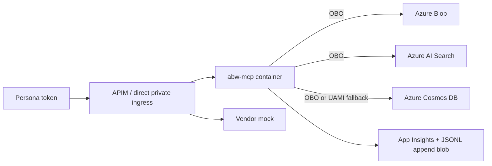

# ABW MCP

`abw-mcp` is the application package for the **Agents Behind the Wall** demo. One container image serves six MCP personalities selected by `MCP_SERVER`.



## Package layout

- `abw_mcp\app.py` - lazy ASGI app factory
- `abw_mcp\auth.py` - JWT validation + `/mcp` auth middleware
- `abw_mcp\obo.py` - federated-credential OBO broker
- `abw_mcp\audit.py` - App Insights/stdout/blob audit sinks
- `abw_mcp\data.py` - Blob/Search/Cosmos client helpers
- `abw_mcp\registry.py` - per-request tool filtering and execution
- `abw_mcp\servers\` - tool definitions for each server

## Environment variables

### Shared

| Variable | Purpose | Required |
|---|---|---|
| `MCP_SERVER` | `research\|wall\|actions\|private\|vendor\|legacy` | yes |
| `TENANT_ID` | Entra tenant for JWT/OBO/PRM metadata | yes |
| `MCP_APP_CLIENT_ID` | API app client ID / `aud` | yes |
| `MCP_ALLOWED_AZP` | Optional comma-separated calling-client allow-list | no |
| `MCP_REQUIRED_SCOPE` | Baseline delegated scope, default `Tools.Read` | no |
| `UAMI_CLIENT_ID` | User-assigned managed identity for OBO/audit | yes |
| `AUDIT_STORAGE_ACCOUNT` | Append-blob audit account | yes |
| `AUDIT_CONTAINER` | Audit container, default `worm-audit` | no |
| `AUDIT_FAIL_CLOSED` | If `true`, blob-audit failures deny calls | no |
| `APPLICATIONINSIGHTS_CONNECTION_STRING` | Enables Azure Monitor export | no |
| `LOG_LEVEL` | Python log level, default `INFO` | no |
| `PUBLIC_BASE_URL` | Optional public URL override for PRM | no |
| `COSMOS_DATABASE` | Cosmos DB name, default `abw` | no |
| `SEARCH_INDEX` | Search index name, default `deals-idx` | no |
| `COSMOS_OBO` | Use user OBO token for Cosmos, default `true` | no |
| `COSMOS_OBO_SCOPE` | Cosmos user scope, default `https://cosmos.azure.com/user_impersonation` | no |
| `MCP_DENIAL_MODE` | `soft` (default): policy denials come back as a normal tool result `{decision:"DENIED", error, message, request_id}` so the model can narrate them; `strict`: MCP `isError=true` | no |

### Server-specific additions

| Server | Extra required env vars |
|---|---|
| `research` | `STORAGE_ACCOUNT`, `SEARCH_ENDPOINT` |
| `wall` | `STORAGE_ACCOUNT`, `SEARCH_ENDPOINT` |
| `actions` | `COSMOS_ENDPOINT` |
| `private` | `COSMOS_ENDPOINT` |
| `vendor` | `VENDOR_API_KEY` |
| `legacy` | `STORAGE_ACCOUNT`, `SEARCH_ENDPOINT`, `COSMOS_ENDPOINT` |

## Tools

| Server | Tool | Summary |
|---|---|---|
| research | `search_research` | Public-search only (`classification eq 'public'`) |
| research | `get_research_note` | Blob read from `research-public/<note_id>.md` |
| wall | `list_my_wall_crossings` | Derives accessible projects from token roles |
| wall | `search_deal_documents` | Search filter is built from token-derived project |
| wall | `get_deal_document` | Reads `wall-<project>/<doc_id>.md` only if token allows it |
| actions | `check_restricted_list` | Reads compliance list with the server UAMI |
| actions | `place_order` | Enforces restricted-list + separation-of-duties before write |
| actions | `list_my_orders` | Lists caller-partitioned orders |
| private | `get_firm_positions` | Desk-partitioned positions query |
| private | `get_credit_limit` | Point-read credit-limit row from `positions` |
| vendor | `get_market_quote` | Deterministic synthetic quote |
| vendor | `get_headlines` | Deterministic synthetic headlines |
| legacy | `search_research` | Broad shared-identity search |
| legacy | `search_deal_documents` | Unfiltered wall/public search |
| legacy | `get_deal_document` | Shared-identity blob read |
| legacy | `place_order` | Writes order without user attribution or compliance block |
| legacy | `get_firm_positions` | Shared-identity positions read |

## Security rules enforced in code

- `/mcp` is bearer-protected for `research`, `wall`, `actions`, and `private`.
- JWT checks: signature, `iss`, `aud`, `tid`, `ver=2.0`, `scp`, optional `azp`, no app-only tokens.
- `tools/list` only returns tools the caller can execute.
- Wall access checks happen twice in code (role gate + doc-id/project check) and again in Storage RBAC.
- `place_order` blocks restricted names and wall-crossed traders before any write.
- Tool audit rows store only `args_sha256` and `result_bytes`, never raw args or document text.
- Vendor flow uses `x-vendor-key` only; the mock logs whether an `Authorization` header arrived.
- Legacy intentionally disables user auth and OBO to demonstrate the anti-pattern.

## Running locally

```powershell
cd <repo-root>\src\mcp
..\..\.venv\Scripts\python.exe -m pip install -e .[test]
..\..\.venv\Scripts\python.exe -m uvicorn abw_mcp.app:app --host 0.0.0.0 --port 8080 --proxy-headers --forwarded-allow-ips *
```

Set the required env vars first. For the vendor mock, include `VENDOR_API_KEY`.

## Tests

```powershell
cd <repo-root>
.\.venv\Scripts\python.exe -m pytest src\mcp\tests -q
```

## Build image

```powershell
cd <repo-root>\src\mcp
..\..\.venv\Scripts\python.exe -m pip install .
docker build -t abw-mcp .
```

## Stage notes

### research
- “Public research works because the user token carries only `Research.Read`, and the search filter hard-codes `classification eq 'public'`.”

### wall
- “The model never even sees Orion tools for a Falcon-only user, and direct calls still fail if it guesses.”

### actions
- “Trading checks the restricted list with the compliance identity, then writes the order as the user unless `COSMOS_OBO=false` is explicitly enabled.”

### private
- “This server is still private-network only in infra, but it also re-validates the JWT inside the container.”

### vendor
- “The external vendor sees only the APIM-injected key. Its logs prove whether an Authorization header leaked.”

### legacy
- “This is the bad old pattern: shared subscription key, shared identity, no user attribution, and no wall controls.”
